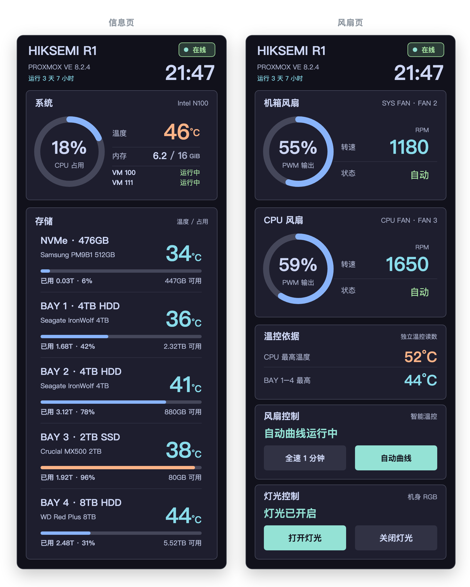

# HIKSEMI R1 · PVE 前屏管理

在海康 R1（型号 `HS-AFS-R1`）上运行 Proxmox VE 时，把这台小主机的**物理前屏、风扇、RGB 灯**和一套 **HTTPS 管理页面**接管起来，让一台原本只能当 NUC 用的机器，变成能看见状态、能调转速、能远程查看的 PVE 节点。



<sub>图中为模拟数据，默认 Mocha 主题。前屏与 Web 管理页共用同一套 SVG 模板渲染，非实机截图。</sub>

---

## 它能做什么

**实体前屏**
376×960 的 DSI 屏按「信息页 → 风扇页 → PVE 控制台 → 黑屏」四页循环，支持触摸双向滑动。信息页显示 CPU、内存、VM 状态，以及 NVMe 和 BAY 1–4 五张硬盘卡的型号、温度、占用率；风扇页显示机箱风扇与 CPU 风扇的转速环形图。

**独立软件温控**
绕过 BIOS 的风扇策略，用 IT8613E 传感器自己算曲线。两路风扇共用一条保守温度曲线，缺传感器或转速为 0 时直接请求全速；「全速」模式 60 秒后自动回落到曲线。

**RGB 灯效**
常亮、呼吸、彩虹与自定义颜色。总线按 PCI 控制器物理路径动态解析，重启后 I²C 编号变化也不会写错设备。

**HTTP 管理页（默认）**
`8080` 端口，默认明文 HTTP，方便内网直接输 IP 访问、避免自签证书告警。需要时可用 `r1_web.py serve --tls` 启用自带自签证书走 HTTPS，或更推荐在前面挂反代（nginx/caddy）做 TLS、由你自行决定如何暴露到公网。未登录时只能看到脱敏的只读双页（硬盘序列号显示为 `****`、虚拟机只显示编号）；登录后可镜像实体屏画面、切页、调亮度、改风扇曲线、控制 RGB、修改密码。

---

## 硬件与系统要求

| 项目 | 要求 |
| --- | --- |
| 机型 | 海康 R1，`/sys/class/dmi/id/board_name` 必须为 `HS-AFS-R1` |
| 屏幕 | 376×960 DSI，`/dev/fb0` |
| 触摸 | `CST0836:00 0911:5288` |
| 传感器 | IT8613E（需要单独构建的 `it87` 内核模块） |
| 系统 | Proxmox VE，systemd，Python 3.12+ |
| 依赖 | 无第三方 Python 包，全部标准库；需要 `openssl` 命令 |

> 前屏的 preflight 脚本会硬校验机型与触摸设备，不匹配直接退出。这个项目**不追求跨机型通用**。

---

## 安装

以下步骤假设部署到 `/root/r1-screen`。所有命令以 root 执行。

### 1. 部署代码

```sh
mkdir -p /root/r1-screen
# 将本仓库内容复制到 /root/r1-screen
cd /root/r1-screen
python3 -m venv .venv
```

项目本身没有第三方依赖，虚拟环境只是为了锁定解释器版本，避免系统 Python 升级时打断服务。

### 2. 准备 IT8613E 驱动

`load_it87_for_curve.sh` 会加载一个**为特定内核版本构建**的 `it87.ko`，并用 SHA-256 与 `vermagic` 双重校验。

内核升级后需要重新构建，不能假定旧模块可用。

### 3. 安装 systemd 服务

```sh
cp r1-panel.service r1-fan-curve.service r1-web.service /etc/systemd/system/
systemctl daemon-reload
systemctl enable r1-panel.service r1-fan-curve.service r1-web.service
```

三个服务的职责与依赖顺序：

- `r1-fan-curve.service` — 温控，最先启动，`ExecStopPost` 会把 PWM 恢复到接管前的值
- `r1-panel.service` — 前屏，依赖温控，启动前跑 `r1_panel_preflight.sh` 等屏幕就绪
- `r1-web.service` — Web，依赖前两者，已做 `ProtectSystem` / `DevicePolicy` 等沙箱限制

### 4. 初始化 Web

```sh
/root/r1-screen/.venv/bin/python /root/r1-screen/r1_web.py init
```

这一步会在 `/var/lib/r1-web/`（权限 0700）下：

- 生成管理员密码摘要，并把**初始密码**写入 `initial-password`（不会打印到终端，需 `cat` 查看）
- 用 `openssl` 生成 P-256 自签证书，并打印 SHA-256 指纹

### 5. 启动与验证

```sh
systemctl start r1-fan-curve.service r1-panel.service r1-web.service
systemctl status r1-panel.service r1-fan-curve.service r1-web.service --no-pager
ss -lnt 'sport = :8080'
cat /run/r1-panel/state.json
cat /run/r1-fan-curve/status.json
```

浏览器访问 `http://<你的IP>:8080`。服务默认监听所有网卡、放行全部 RFC1918 私网与回环，因此在任意内网段都能直接访问；如需收紧来源，用环境变量 `R1_WEB_ALLOWED`（逗号分隔 CIDR，如 `192.168.1.0/24,10.0.0.0/8`）限定。若需 HTTPS：① 直接 `serve --tls`（启用自带自签证书，首次仍需手动信任），或 ② 在前端挂反代做 TLS（推荐，便于公网暴露，同时保留 HTTP 内网直连）。

### 可选：群晖 SATA 占用率

信息页四个 SATA 盘位的占用率来自群晖的只读 SSH 查询，需要你自己准备：

1. 在 R1 上生成**仅限查询**的 SSH 密钥，固定群晖主机指纹
2. 在群晖账户授权中加来源限制、`restrict`，并强制只允许执行 `r1_dsm_usage.sh`
3. 在 `/var/lib/r1-panel/storage-usage.json`（权限 600）填 `host`、`user`、`vmid`、`identity_file`、`known_hosts_file`，非默认端口加 `port`

查询失败、单卷跨盘或盘位映射不明确时，卡片显示 `--`，**不会猜测使用率**。不配置这一项不影响其他功能。

---

## 卸载

### 完全卸载

```sh
# 1. 先停前屏 —— 它会自动恢复控制台光标、背光与 tty1
systemctl stop r1-panel.service

# 2. 停其余服务（温控会恢复接管前的 PWM）
systemctl disable --now r1-fan-curve.service r1-web.service

# 3. 删除服务定义
rm -f /etc/systemd/system/r1-panel.service \
      /etc/systemd/system/r1-fan-curve.service \
      /etc/systemd/system/r1-web.service
systemctl daemon-reload

# 4. 删除程序与运行时数据
rm -rf /root/r1-screen
rm -rf /var/lib/r1-panel /var/lib/r1-fan-curve /var/lib/r1-web
```

**顺序很重要**：先停前屏再删文件。前屏进程被强杀时不会走 `ExecStopPost`，屏幕可能停在黑屏或残留光标状态；真遇到了就手动执行 `r1_panel_restore_tty.sh`，或者切一次 `chvt 1`。

卸载后如果风扇没有回到原来的行为，检查 `it87` 模块是否还在加载、BIOS 风扇策略是否被改动。

### 只停某一部分

```sh
systemctl stop r1-panel.service      # 只关前屏，温控和 Web 继续跑
systemctl stop r1-fan-curve.service  # 只关温控，风扇交回硬件默认
systemctl stop r1-web.service        # 只关 Web，前屏不受影响
```

想关掉开机自启但保留手动启动：`systemctl disable r1-panel.service`。

---

## 能力边界

### 已验证

- 前屏四页顺序、正反双向滑动、黑屏返回控制台文字完整
- 两路风扇转速读取与曲线控制，全速模式 60 秒自动回落
- RGB 常亮 / 呼吸 / 彩虹 / 颜色，重启后总线重定位正常
- Web 免登录脱敏双页、登录后管理、改密后旧会话失效
- 70 项离线单元测试（`python -m unittest discover -s tests -v`）

### 尚未验证

- **整机重启后的前屏显示**：部分版本未复测，早期出现过 i915/DSI 旧帧故障
- **长时间热循环与内核升级兼容性**：`it87` 是固定版本构建，内核一变就要重来
- **Web 控制台页的反向切页**：从黑屏反向进入控制台只显示光标，因此该切页按钮仍禁用

### 明确不做

- 不安装 R1 Toolbox 的 fnOS 包，不复制其专有程序，不强制 `force_id`
- 不扫描整条 I²C 总线，RGB 只定点访问已验证地址
- Web 控制台只镜像画面，**不能**在网页里输入命令
- 不在仓库内分发 `it87` 驱动二进制

### 重要提醒

单元测试只覆盖不接触硬件的逻辑。**驱动探测、I²C 写入、屏幕实际观感必须现场实测**，离线测试通过不等于硬件正常。

---

## 安全说明

- 仓库**不含**主机密钥、群晖授权、证书、密码、硬盘序列号或任何本机配置。`.gitignore` 已覆盖 `*.bak`、`*.pem`、`*.key`、`known_hosts*`、`storage-usage.json` 等易误提交的类型。
- Web 有 8 小时会话、CSRF 校验和来源限制，但这些是**应用层**措施。
- **PVE 主机防火墙默认没有启用**，应用层限制不能替代网络层访问控制。公网暴露前请自行配置防火墙或走内网/VPN。
- Web 只能提交风扇曲线和「全速/自动」请求，不能直接写 PWM；新曲线不得低于已验证基准。

---

## 目录说明

| 文件 | 作用 |
| --- | --- |
| `r1_panel_next.py` / `r1_panel_repository.py` / `r1_panel_runtime.py` | 前屏主程序、绘制与运行时状态 |
| `r1_svg_painter.py` / `r1_theme.py` | SVG 渲染与主题（Catppuccin Mocha） |
| `r1_fan_curve.py` / `r1_fan_control_ipc.py` / `r1_fan_config.py` | 温控曲线、IPC、配置校验 |
| `r1_rgb_control.py` / `r1_rgb_probe.py` | RGB 控制与定点探测 |
| `r1_web.py` / `r1_web.html` / `r1_web_views.py` / `r1_web_capacity.py` | HTTP/HTTPS 服务与页面渲染 |
| `r1_storage_usage.py` / `r1_dsm_usage.sh` | 群晖只读占用率采集 |
| `*.service` | systemd 服务定义 |
| `r1_panel_preflight.sh` / `r1_panel_restore_tty.sh` / `load_it87_for_curve.sh` | 启动前置检查、控制台恢复、驱动加载 |
| `tests/` | 不接触硬件的离线测试 |
| `ui_preview.py` | 无硬件模拟预览，运行方式见 `docs/ui-preview.md` |
| `HARDWARE.md` | 硬件探测记录 |
| `docs/web.md` | Web 管理页的架构、访问方式、维护命令与安全边界 |
| `docs/ui-preview.md` | 本地模拟预览的运行方式，以及它「不是什么」 |
| `docs/images/preview.png` | 首屏预览图（模拟数据渲染，非实机截图） |

---

## 许可

代码采用 **[PolyForm Noncommercial License 1.0.0](LICENSE)** —— 允许个人学习、研究、修改与非商业分发，**禁止商业使用**。

需要说清楚：这属于 **source-available（源码公开）**，不是 OSI 定义下的「开源」。OSI 的开源定义不允许限制使用领域，所以任何禁止商用的协议都无法被认定为开源许可证。

`assets/fonts/` 下的 Noto Sans SC 字体遵循 **SIL Open Font License 1.1**，许可证全文见 `assets/fonts/OFL.txt`，与本项目自身的许可相互独立。

---

## 版本

每个版本的变更内容、验收记录与部署注意事项，都写在对应的 [Releases](https://github.com/7s8x/hiksemi-r1-panel/releases) 说明里。
