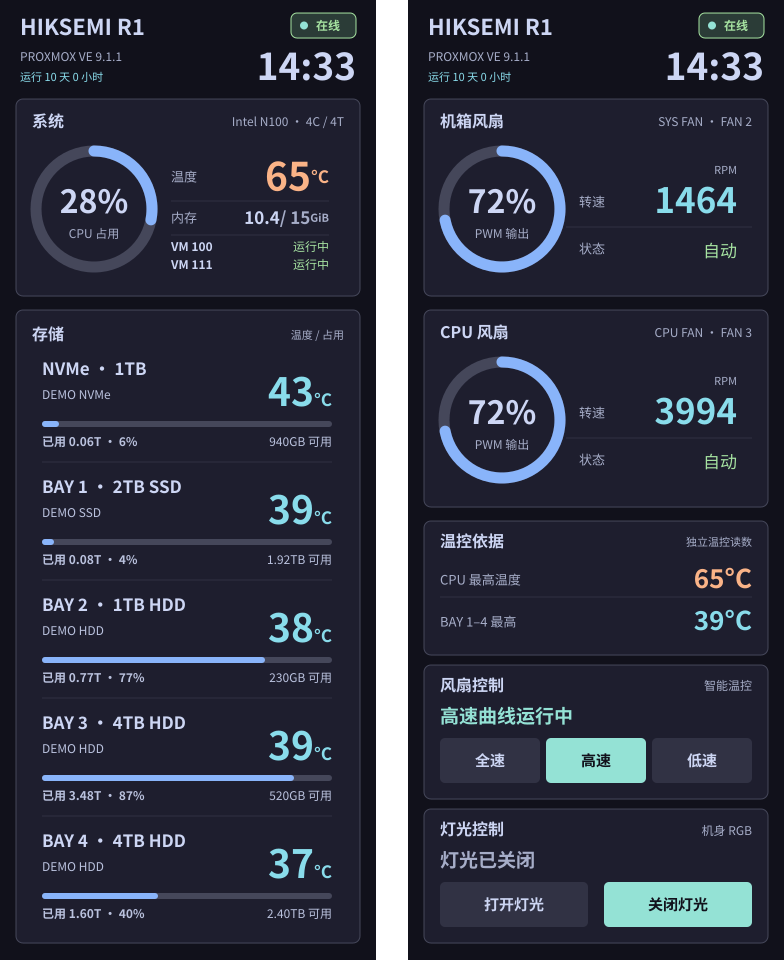

# HIKSEMI R1 · PVE 前屏管理

在海康 R1（型号 `HS-AFS-R1`）上运行 Proxmox VE 时，把这台小主机的**物理前屏、风扇、RGB 灯**和一套 **内网 Web 管理页面**接管起来，让一台原本只能当 NUC 用的机器，变成能看见状态、能调转速、能远程查看的 PVE 节点。



<sub>图中为模拟数据，默认 Mocha 主题。前屏与 Web 管理页共用同一套 SVG 模板渲染，非实机截图。</sub>

---

## 它能做什么

**实体前屏**
376×960 的 DSI 屏按「信息页 → 风扇页 → PVE 控制台 → 黑屏」四页循环，支持触摸双向滑动。信息页显示 CPU、内存、VM 状态，以及 NVMe 和 BAY 1–4 五张硬盘卡的型号、温度、占用率；风扇页显示机箱风扇与 CPU 风扇的转速环形图。

**独立软件温控**
绕过 BIOS 的风扇策略，用 IT8613E 传感器自己算曲线。FAN2（机箱）按在位 SATA 盘最高温度及 CPU 高温辅助曲线中较高者调整，FAN3（CPU）独立按 CPU 曲线调整。PWM 最低 120；应在位盘缺失、传感器或盘位映射异常、风扇停转时请求两路全速。风扇有「标准」「静音」两套独立 PWM 曲线，可分别编辑；「全速」是 60 秒临时覆盖，到期自动回落到进入全速前所选的档位。

**RGB 灯效**
常亮、呼吸、彩虹与自定义颜色。总线按 PCI 控制器物理路径动态解析，重启后 I²C 编号变化也不会写错设备。

**HTTP 管理页（默认）**
`8080` 端口，默认明文 HTTP，方便内网直接输 IP 访问、避免自签证书告警。HTTP 不加密登录信息，仅用于可信内网；不要直接映射到公网。可显式配置 TLS 或受信任反向代理。未登录时只能看到脱敏的只读双页（硬盘序列号显示为 `****`、虚拟机只显示编号）；登录后可镜像实体屏画面、切页、调亮度、改风扇曲线、控制 RGB、修改密码。

---

## 硬件与系统要求

| 项目 | 要求 |
| --- | --- |
| 机型 | 海康 R1，`/sys/class/dmi/id/board_name` 必须为 `HS-AFS-R1` |
| 屏幕 | 376×960 DSI，`/dev/fb0` |
| 触摸 | `CST0836:00 0911:5288` |
| 传感器 | IT8613E（需要单独构建的 `it87` 内核模块） |
| 系统 | Proxmox VE，systemd，Python 3.12+ |
| 依赖 | 无第三方 Python 包，全部标准库；Linux 系统需 Cairo（`libcairo2`）、Fontconfig（`libfontconfig1`）、项目附带 OFL 字体、PVE 的 `pvesh`/`pvesm`/`qm`；仅 `init --tls` 需要 `openssl` |

> 前屏的 preflight 脚本会硬校验机型与触摸设备，不匹配直接退出。这个项目**不追求跨机型通用**。

---

## 安装

以下步骤假设部署到 `/root/r1-screen`。所有命令以 root 执行。

### 1. 部署代码

先确认这是目标 PVE 主机，并准备系统运行库。以下软件来自 Debian/PVE 已配置的软件源，不需要通过 pip 安装项目依赖；若 APT 源不可用，应先处理源或网络，不跳过签名校验。

```sh
apt-get update
apt-get install --no-install-recommends python3 python3-venv libcairo2 libfontconfig1 fontconfig kbd kmod iproute2
# 仅使用可选 HTTPS 时需要：
apt-get install --no-install-recommends openssl
# 仅配置群晖容量查询时需要：
apt-get install --no-install-recommends openssh-client
```

```sh
mkdir -p /root/r1-screen
# 将本仓库内容复制到 /root/r1-screen
cd /root/r1-screen
python3 -m venv .venv
```

项目 Python 代码仅使用标准库；绘制仍依赖系统 Cairo、Fontconfig 与随包字体。虚拟环境隔离项目解释器入口，但不保证固定底层系统 Python；系统升级后仍应复核虚拟环境和服务。

### 2. 准备 IT8613E 驱动

`load_it87_for_curve.sh` 会加载一个**为特定内核版本构建**的 `it87.ko`，并用 SHA-256 与 `vermagic` 双重校验。

内核升级后需要重新构建，不能假定旧模块可用。模块来源、构建与许可见 [硬件记录](HARDWARE.md)。本项目不会自动下载或构建驱动，模块加载本身可能写硬件寄存器。

在 `/var/lib/r1-panel/driver.env` 设置审核过的绝对路径 `R1_IT87_MODULE` 和 SHA-256 `R1_IT87_SHA256`；不要照抄其他机器的模块。

先创建本机配置目录并复制示例（已有配置的升级场景不要覆盖）：

```sh
install -d -m 0700 /var/lib/r1-panel
install -m 0600 site.example.json /var/lib/r1-panel/site.json
```

随后按实机设置 PVE 节点、最多两台 VM、NVMe 存储源、SATA 控制器及 BAY 映射、`occupied_bays`。允许 0–4 块 SATA：有意空置的盘位不计为缺盘；配置为在位却丢失、出现未登记硬盘或传感器归属不明会触发保护。进程启动时读取配置，修改后须受保护重启相关服务。存储源必须确实属于所显示的 NVMe，不要把多盘存储池当作单盘用量。

在已有模块路径和校验值审核通过后，将其写入`/var/lib/r1-panel/driver.env`（权限0600），格式为两行`R1_IT87_MODULE=/绝对路径/it87.ko`与`R1_IT87_SHA256=审核后的64位摘要`；不要填示例路径或复制其他机器的模块。先将同一模块路径与校验值作为环境变量传给 `.venv/bin/python r1_doctor.py` 做只读预检；直接运行时不会自动执行 `driver.env`，systemd 则通过服务中的 `EnvironmentFile` 读取它。该命令不加载模块、不写 PWM/RGB，不替代现场验收。

### 3. 安装 systemd 服务

```sh
cp r1-panel.service r1-fan-curve.service r1-web.service r1-collector.service /etc/systemd/system/
systemctl daemon-reload
systemctl enable r1-panel.service r1-fan-curve.service r1-web.service r1-collector.service
```

四个服务的职责与依赖顺序：

- `r1-fan-curve.service` — 温控，最先启动，停止时按传感器、盘位和温度安全条件设置 120 或保留全速，不保证交回 BIOS 自动模式
- `r1-collector.service` — 共享只读采集，温度/负载每 5 秒、VM 每 60 秒、NVMe 容量每 300 秒、可选群晖容量每 1800 秒；独立于温控
- `r1-panel.service` — 前屏，依赖温控与共享采集器，启动前跑 `r1_panel_preflight.sh` 等屏幕就绪
- `r1-web.service` — Web，依赖前屏、温控与共享采集器，已做 `ProtectSystem` / `DevicePolicy` 等沙箱限制

### 4. 初始化 Web

```sh
/root/r1-screen/.venv/bin/python /root/r1-screen/r1_web.py init
```

这一步会在 `/var/lib/r1-web/`（权限 0700）下：

- 首次初始化默认选择 Mocha；已有主题设置保持不变
- 生成管理员密码摘要，并把**初始密码**写入 `initial-password`（不会打印到终端，需 `cat` 查看）
- HTTP 初始化不调用 `openssl`；修改密码成功后清理初始密码文件。清理失败会记操作错误，但不回滚已提交的新密码。

### 5. 启动与验证

```sh
systemctl start r1-fan-curve.service r1-collector.service r1-panel.service r1-web.service
systemctl status r1-panel.service r1-fan-curve.service r1-web.service r1-collector.service --no-pager
ss -lnt 'sport = :8080'
cat /run/r1-panel/state.json
cat /run/r1-fan-curve/status.json
```

浏览器访问 `http://<你的IP>:8080`。默认监听 `0.0.0.0:8080`，允许全部 RFC1918 私网、回环与 CGNAT。此默认来源范围不区分内网用户，管理员密码及防火墙仍须自行维护。IPv6 监听不在本版默认范围。

在 `/var/lib/r1-web/web.env` 设置环境变量（systemd 自动读取；直接执行时也可用 shell 环境变量）：

```ini
R1_WEB_ALLOWED=192.168.1.0/24,127.0.0.1/32
# 仅受信代理可提供 X-Forwarded-Proto/Host，代理须覆盖客户端传入值
R1_WEB_TRUSTED_PROXIES=127.0.0.1/32
# 可选：禁止匿名双页查看，管理员登录后仍可查看
R1_WEB_PUBLIC=0
# 可选：关闭本地访问日志
R1_WEB_LOG=0
```

示例地址仅为配置示意，请填自己的地址。应用不再限制访问域名，域名策略由反向代理管理；仍检查 Host 格式、来源网络、管理员认证及同源请求。使用反代时仅将实际代理来源加入 R1_WEB_TRUSTED_PROXIES，并由代理覆盖 X-Forwarded-Proto/Host。旧 R1_WEB_HOSTS 配置不再使用。

TLS 为可选：先执行 `.venv/bin/python r1_web.py init --tls --tls-name <实际IP或域名>`，再在 systemd override 中设置 `ExecStart` 为带 `serve --tls` 的命令；也可传入 `--cert` 和 `--key` 使用自己管理的证书。自签证书仍需要客户端信任。

Web 最多 32 个活动连接，空闲或读报文超时 15 秒；HTTP/1.1 错误响应关闭连接。TLS 握手也计入连接上限并受超时约束。日志默认 `/var/lib/r1-web/access.log`、0600 权限，单文件 1 MB、3 个备份；不记录正文、Cookie、查询参数或控制台图像。

### 可选：群晖 SATA 占用率

信息页四个 SATA 盘位的占用率来自群晖的只读 SSH 查询，需要你自己准备：

1. 在 R1 上生成**仅限查询**的 SSH 密钥，固定群晖主机指纹
2. 在群晖账户授权中加来源限制、`restrict`，并强制只允许执行 `r1_dsm_usage.sh`
3. 在 `/var/lib/r1-panel/storage-usage.json`（权限 600）填 `host`、`user`、`vmid`、`identity_file`、`known_hosts_file`，非默认端口加 `port`

查询失败、单卷跨盘或盘位映射不明确时，卡片显示 `--`，**不会猜测使用率**。不配置这一项不影响其他功能。

---

## 卸载

### 完全卸载

```sh
# 1. 先停前屏 —— 它会自动恢复控制台光标、背光与 tty1
systemctl stop r1-panel.service

# 2. 停其余服务（温控会按安全条件恢复基线或保留全速）
systemctl disable --now r1-fan-curve.service r1-web.service r1-collector.service

# 3. 删除服务定义
rm -f /etc/systemd/system/r1-panel.service \
      /etc/systemd/system/r1-fan-curve.service \
      /etc/systemd/system/r1-web.service \
      /etc/systemd/system/r1-collector.service
systemctl daemon-reload

# 4. 删除程序与运行时数据
rm -rf /root/r1-screen
rm -rf /var/lib/r1-panel /var/lib/r1-fan-curve /var/lib/r1-web
```

**顺序很重要**：先停前屏再删文件。前屏进程被强杀时不会走 `ExecStopPost`，屏幕可能停在黑屏或残留光标状态；真遇到了就手动执行 `r1_panel_restore_tty.sh`，或者切一次 `chvt 1`。

卸载后如果风扇没有回到原来的行为，检查 `it87` 模块是否还在加载、BIOS 风扇策略是否被改动。

### 只停某一部分

```sh
systemctl stop r1-panel.service      # 只关前屏，温控和 Web 继续跑
systemctl stop r1-fan-curve.service  # 只关温控，按安全条件保留基线或全速
systemctl stop r1-web.service        # 只关 Web，前屏不受影响
```

想关掉开机自启但保留手动启动：`systemctl disable r1-panel.service`。

---

## 能力边界

### 已验证

- 前屏四页顺序、正反双向滑动、黑屏返回控制台文字完整
- 两路风扇转速读取与标准/静音双档曲线控制，全速模式 60 秒后回落到原档位
- RGB 常亮 / 呼吸 / 彩虹 / 颜色，重启后总线重定位正常
- Web 免登录脱敏双页、登录后管理、改密后旧会话失效
- 当前源码的 203 项受防护离线测试（`.venv/bin/python -B run_offline_tests.py`），覆盖共享采集、数据失效、盘位映射、曲线降级及保存回退、Web 与渲染等逻辑；曲线编辑器异步交互另用 `node tests/test_curve_editor.cjs` 与 `node tests/test_rgb_controls.cjs` 验证

### 尚未验证

- **整机重启后的前屏显示**：部分版本未复测，早期出现过 i915/DSI 旧帧故障
- **长时间热循环与内核升级兼容性**：`it87` 是固定版本构建，内核一变就要重来
- **目标机器的显示链路兼容性**：Web 已提供控制台切页入口，但不能据此保证每台机器的黑屏唤醒或控制台恢复；升级后仍须现场复核

### 明确不做

- 不安装 R1 Toolbox 的 fnOS 包，不复制其专有程序，不强制 `force_id`
- 不扫描整条 I²C 总线，RGB 只定点访问已验证地址
- Web 控制台只镜像画面，**不能**在网页里输入命令
- 不在仓库内分发 `it87` 驱动二进制

### 重要提醒

单元测试只覆盖不接触硬件的逻辑。**驱动探测、I²C 写入、屏幕实际观感必须现场实测**，离线测试通过不等于硬件正常。

---

## 安全说明

- 仓库**不含**主机密钥、群晖授权、证书、密码、硬盘序列号或任何本机配置。`.gitignore` 已覆盖 `*.bak`、`*.pem`、`*.key`、`known_hosts*`、`storage-usage.json` 等易误提交的类型。
- Web 有 8 小时会话、CSRF 校验和来源限制，但这些是**应用层**措施。
- **PVE 主机防火墙默认没有启用**，应用层限制不能替代网络层访问控制。公网暴露前请自行配置防火墙或走内网/VPN。
- Web 只能提交两套风扇曲线和「全速/标准/静音」请求，不能直接写 PWM；标准档不得低于已验证基准，静音档可更平缓但不得低于 PWM 120，且须在紧急温度前达到全速。静音档降低散热余量，启用前需现场温度复核。

---

## 目录说明

| 文件 | 作用 |
| --- | --- |
| `r1_panel_next.py` / `r1_panel_repository.py` / `r1_panel_runtime.py` | 前屏主程序、绘制与运行时状态 |
| `r1_host_sampling.py` / `r1_storage_queries.py` | 主机只读采样、严格 SSH 与容量查询；由共享采集器统一调度 |
| `r1_snapshot.py` / `r1_display_refresh.py` / `r1_public_frames.py` | 快照契约、实体屏内容缓存与公共 PNG 按需编码 |
| `r1_rgb_io.py` | 正式 RGB 控制与兼容试验入口共用的底层接口 |
| `r1_collection.py` | 共享只读采集、原子快照、独立数据有效期及换盘失效保护 |
| `r1_svg_painter.py` / `r1_theme.py` | SVG 渲染与主题（Catppuccin Mocha / Latte） |
| `r1_fan_curve.py` / `r1_fan_control_ipc.py` / `r1_fan_config.py` | 温控曲线、IPC、配置校验 |
| `r1_rgb_control.py` / `r1_rgb_probe.py` | RGB 控制与定点探测 |
| `r1_web.py` / `r1_web.html` / `r1_web_views.py` | HTTP/HTTPS 服务与共享画面渲染，PNG 复用已生成的 SVG |
| `r1_storage_usage.py` / `r1_web_capacity.py` | 旧模块兼容导出；实际查询位于 `r1_storage_queries.py`，不单独维护缓存 |
| `r1_dsm_usage.sh` | DSM 端受限只读容量命令，与主机查询协议配套 |
| `*.service` | systemd 服务定义 |
| `r1_panel_preflight.sh` / `r1_panel_restore_tty.sh` / `load_it87_for_curve.sh` | 启动前置检查、控制台恢复、驱动加载 |
| `tests/` | 不接触硬件的离线测试 |
| `ui_preview.py` | 无硬件模拟预览，运行方式见 `docs/ui-preview.md` |
| `HARDWARE.md` | 硬件探测记录 |
| `docs/web.md` | Web 管理页的架构、访问方式、维护命令与安全边界 |
| `docs/ui-preview.md` | 本地模拟预览的运行方式，以及它「不是什么」 |
| `docs/images/preview.svg` | 首屏预览图（模拟数据渲染，非实机截图） |

---

## 许可

代码采用 **[MIT License](LICENSE)**，版权署名为 `Copyright (c) 2026 7s8x`。允许使用、修改、分发及商业使用；分发时须保留版权声明和许可文本。软件按原样提供，不提供担保。

`assets/fonts/` 下的 Noto Sans SC 字体遵循 **SIL Open Font License 1.1**，许可证全文见 `assets/fonts/OFL.txt`，与本项目自身的许可相互独立。

---

## 版本

每个版本的变更内容、验收记录与部署注意事项，都写在对应的 [Releases](https://github.com/7s8x/hiksemi-r1-panel/releases) 说明里。

## 升级与回退

升级前备份运行代码、服务定义和本机配置（凭据另行安全保管，不上传）。对比发布文件清单，仅更新该版本需要的程序；不覆盖本机 site、存储 SSH、主题和曲线配置。先离线测试与只读预检，再安排独立自动回退和现场短测；涉及采集、温控或显示链路的变更，还需按发布验收计划完成持续观察与现场复核；各版实际验证范围见对应 Release。失败时恢复备份及服务配置，不重启 PVE 或修改虚拟机。历史版本的校验清单不可用于核验当前代码。

原子替换、文件同步与运行状态有效期的边界见 [原子写语义说明](docs/atomic-writes.md)。

控制页把温控依据与三档操作合并为197px高的风扇控制卡，灯光区211px高，提供呼吸、常亮、关闭三按钮；沿用现有颜色和灯效授权，关闭状态不展示旧灯效。

登录后的实体屏实时镜像默认折叠，展开才获取PNG；收起或页面转入后台时停止取图，切页和亮度控制仍可直接使用。上方Web双页继续使用SVG。
